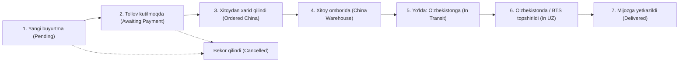

# 📋 TEXNIK VAZIFA (TZ / TECHNICAL SPECIFICATION)

**Loyiha nomi:** Onlayn kiyim do‘konlari va Xorijdan buyurtma (Preorder) tizimlari uchun Avtomatlashtirilgan CRM va Telegram Mini App platformasi  
**Hujjat versiyasi:** 1.0  
**Tizim kodi:** `WHITMORE-CORE`  
**Sana:** 2026-yil  

---

## 1. LOYIHA HAQIDA VA ASOSIY MAQSAD

### 1.1. Loyiha maqsadi
Ushbu loyihaning asosiy maqsadi — O‘zbekistondagi onlayn kiyim do‘konlari, xususan xorijdan (Xitoy (1688, Taobao), Turkiya, AQSH, Dubay) buyurtma asosida ishlovchi ("preorder") bizneslar uchun **buyurtma olishdan tortib to mijoz qo‘liga yetkazib berishgacha bo‘lgan barcha jarayonlarni 100% avtomatlashtiruvchi tayyor CRM va e-tijorat ekotizimini** yaratishdir.

### 1.2. Hozirgi muammolar (As-Is):
* **Telegram/Instagram Direct tartibsizligi:** Buyurtmalar chatlarda yo‘qolib qoladi, mijozning o‘lchami (bo‘yi, vazni) esdan chiqadi.
* **Xitoydan xarid chalkashligi:** Qaysi tovar sotib olindi, qaysi biri Xitoy omborida, qaysisi O‘zbekistonga yo‘lga chiqqanini kuzatish qiyin.
* **Kargo va narx hisoblash murakkabligi:** Yuan kursi, og‘irlik tarifi va ustama foizi Excelda qo‘lda hisoblanadi.
* **Mijozlarning tinimsiz savollari:** "Zakazim qayerda qoldi?", "Qachon yetib keladi?" degan savollarga menejerlar vaqt sarflaydi.

### 1.3. Tizim yechimi (To-Be):
* **Telegram Mini App:** Zamonaviy, ilova darajasidagi do‘kon interfeysi (katalog, o‘lchamlar, savatcha, karta to‘lovi).
* **Kanban CRM doskasi:** Buyurtmalarni bosqichma-bosqich (drag-and-drop) boshqarish.
* **Avtomatik Telegram xabarlari:** Buyurtma holati o‘zgarganda (masalan, "Xitoy omboriga yetib keldi" yoki "BTS pochtaga topshirildi") mijozga avtomat xabar boradi.
* **Mijozning 360° profili:** Har bir xaridorning barcha tana o‘lchamlari va xaridlar tarixi bitta joyda saqlanadi.
* **Multi-Store (White-label):** Ushbu tizimni 15 soniyada yangi brend nomiga moslab klonlash va 10+ ta do‘konga alohida sotish imkoniyati.

---

## 2. FOYDALANUVCHI ROLLARI VA RUXSATLAR

| Rol | Kirish joyi | Asosiy huquq va vazifalari |
| :--- | :--- | :--- |
| **Mijoz (Xaridor)** | Telegram Bot & Mini App | Katalog ko‘rish, filterlash, o‘lcham tanlash, buyurtma berish, kargo holatini onlayn kuzatish. |
| **Do‘kon egasi (Owner / Superadmin)** | Web Admin Panel | To‘liq huquq: sozlamalar, narx va kurslar, moliya, statistika, tovar qo‘shish, xodimlar boshqaruvi, DB zaxirasi. |
| **Menejer / Operator** | Web Admin Panel | Buyurtmalarni qabul qilish, to‘lovni tasdiqlash, kargo holatini o‘zgartirish, mijozlar bilan aloqa. |
| **Xitoy ta’minotchisi (Ops)** | Web Admin Panel | Xarid qilinishi kerak bo‘lgan tovarlar ro‘yxati (China-list), xarid havolalari va trek-kodlarni biriktirish. |

---

## 3. TEXNOLOGIYALAR STEKI (TECH STACK)

* **Backend:** Python 3.11+, FastAPI (yuqori tezlikdagi asinxron API), Uvicorn ASGI server.
* **ORM & Baza:** SQLAlchemy 2.0, Alembic (migratsiyalar), SQLite (mustaqil do‘konlar uchun) / PostgreSQL 16 (bulutli serverlar uchun).
* **Telegram Bot:** Aiogram 3.x (asinxron bot freymvorki).
* **Frontend:** React 18, TypeScript, Vite, Tailwind CSS (zamonaviy adaptiv luxury dizayn).
* **Xavfsizlik:** PBKDF2 / Bcrypt parollar xeshlash, HttpOnly Session Cookie, CSRF himoya, Rate limiting.
* **Logistika integratsiyasi:** BTS Pochta, EMU Pochta kuryersiz, faqat filial orqali tarqatish tizimi.

---

## 4. FUNKSIONAL TALABLAR (MODULES SPECIFICATION)

### 4.1. Telegram Mini App (Xaridor interfeysi)
1. **Bosh sahifa va Katalog:**
   * Zamonaviy interaktiv toifalar (👔 Kostyumlar, 👞 Poyabzallar, 👖 Shimlar, 🧥 Kurtkalar, 🎒 Aksessuarlar).
   * Jonli qidiruv va filtrlar (Mavjud tovarlar, Buyurtmaga — Preorder, narx bo‘yicha tartiblash).
   * Mahsulot kartasi: fotogalereya, tavsif, material tarkibi, narx, o‘lcham tanlash.
2. **O‘lchamlar bo‘yicha sartorial yo‘riqnoma (Size Chart):**
   * Ko‘krak qafasi, bel, yelka va uzunlik bo‘yicha aniq sm ko‘rsatkichlari.
   * Xaridor o‘z bo‘yi va vaznini kiritishi uchun maydonlar.
3. **Savatcha va Buyurtma rasmiylashtirish:**
   * Yetkazib berish turi: **Faqat Pochta orqali (BTS / EMU)**. Kuryerlik yo‘q.
   * Xaridor ma’lumotlari: Ism, Familiya, Telefon, Viloyat, Tuman, Pochta filiali manzili.
4. **To‘lov moduli:**
   * Do‘kon egasining kartasi (Uzcard/Humo), to‘lanishi kerak bo‘lgan summa (50% avans yoki 100%).
   * To‘lov chekini (skrinshot) yuklash imkoniyati.
5. **Kargo kuzatish sahifasi (Tracking):**
   * 7 bosqichli vizual tranzit shkalasi orqali buyurtmaning joriy holati.

---

### 4.2. CRM va Buyurtmalar Tranziti (Kanban doskasi)
Buyurtmalar qat'iy 7 ta holat bo‘yicha harakatlanadi:

* **Avtomatik Telegram xabarnomasi:** Har bir bosqichga o‘tganda tizim mijozga o‘zbek yoki rus tilida chiroyli xabar yuboradi (masalan: *"Hurmatli mijoz, buyurtmangiz Xitoy omboriga qabul qilindi va Toshkentga jo‘natishga tayyorlanmoqda. Trek-kod: CN-8829"*).

---

### 4.3. Avtomatlashtirilgan Narx va Kargo Kalkulyatori
Tovar narxi do‘kon egasi tomonidan qo‘lda hisoblanmaydi, tizim formula bo‘yicha avtomatik chiqaradi:
$$\text{Yakuniy Narx (UZS)} = (\text{Yuan Narxi} \times \text{Yuan Kursi}) + (\text{Og'irlik (kg)} \times \text{Kargo Tarifi}) + \text{Foyda Ustamasi (\%)} + \text{Pochta Xarajati}$$

* Agar yuan kursi yoki kargo narxi o‘zgarsa, tizim 1 tugma bilan bazadagi barcha 1,000+ ta tovar narxini avtomatik qayta hisoblab chiqadi.

---

### 4.4. Mijozlarning 360° Sartorial Profili
Har bir xaridor uchun CRM kartochkasi:
* Mijozning tana o‘lchamlari (Bo‘yi, vazni, kiyim va poyabzal o‘lchami).
* Jami buyurtmalar soni va umumiy xarid summasi (LTV).
* Oxirgi xarid qilgan sanasi va afzal ko‘rgan toifalari.
* Ichki admin eslatmalari ("Doimiy mijoz, 10% chegirma berilsin").

---

### 4.5. White-label va Multi-store Klonlash Mexanizmi
Tizimni 10 ta turli xil kiyim do‘koniga mustaqil qilib o‘rnatib berish arxitekturasi:
* Har bir do‘kon uchun alohida katalog, alohida `.env`, alohida SQLite bazasi va alohida Telegram bot.
* Bitta do‘konning ma'lumotlari ikkinchisiga mutlaqo aralashmaydi.
* Klonlash skripti: `python setup_store.py --name "BrandName" --bot_token "TOKEN" --port 8001` buyrug‘i orqali to‘liq avtomatlashgan.

---

## 5. NOFUNKSIONAL TALABLAR (NON-FUNCTIONAL REQUIREMENTS)

1. **Tezkorlik (Performance):**
   * Mini App sahifalari yuklanishi: 1.2 soniyadan kam.
   * API so‘rovlarga javob qaytarish vaqti: 100 ms dan kam.
2. **Xavfsizlik (Security):**
   * Ma'muriy kirish parollari kamida 10 ta belgidan iborat bo‘lishi shart.
   * Telegram WebApp ma'lumotlari HMAC-SHA256 orqali bot tokeni bilan tekshiriladi.
   * Xakerlik va SQL injection xavflariga qarshi SQLAlchemy parametrli so‘rovlar.
3. **Zaxira nusxa (Backup):**
   * Baza faylini (`whitmore.db`) admin panel orqali 1 klikda `.db` formatida yuklab olish.
4. **Moslashuvchanlik (Responsive Design):**
   * Mini App iOS, Android va Telegram Desktop'da 100% moslashuvchan.
   * Admin panel kompyuter, noutbuk va planshetlarda to‘liq ishlaydi.

---

## 6. MA'LUMOTLAR BAZASI SXEMASI (ASOSIY JADVALLAR)

1. `admin_accounts`: Admin va xodimlar profillari, rollar, parollar.
2. `categories`: Tovar bo‘limlari (uz, ru, tartib raqami, ikonka).
3. `products`: Mahsulotlar (nomi, narxi, yuanda, kg, turi — stock/preorder, tavsifi).
4. `product_variants`: O‘lcham va ranglar, qoldiq soni.
5. `orders`: Buyurtmalar (kod, mijoz ismi, tel, viloyat, pochta filiali, holat, jami summa).
6. `order_items`: Buyurtma tarkibidagi tovarlar ro‘yxati.
7. `customer_profiles`: Mijozning 360° o‘lchamlari va profili.
8. `crm_tasks`: Operatorlar uchun eslatmalar va vazifalar doskasi.
9. `system_settings`: Yuan kursi, kargo tarifi, karta raqami, brend nomi.

---

## 7. LOYIHANI TOPSHIRISH TARKIBI (DELIVERABLES)
1. Ishchi kodlar ombori (`backend`, `frontend`).
2. Avtomatik o‘rnatish va ishga tushirish skriptlari (`install.bat`, `run.bat`, `install.sh`, `run.sh`).
3. Yangi do‘konlarni yaratish mexanizmi (`setup_store.py`).
4. To‘liq o‘rnatish qo‘llanmasi (`INSTALL.md`).
5. Foydalanish yo‘riqnomasi (`FOYDALANISH_QOLLANMASI.md`).
6. Investorlar va mijozlar uchun taqdimot (`PREZENTATSIYA.html` va `PREZENTATSIYA.md`).

